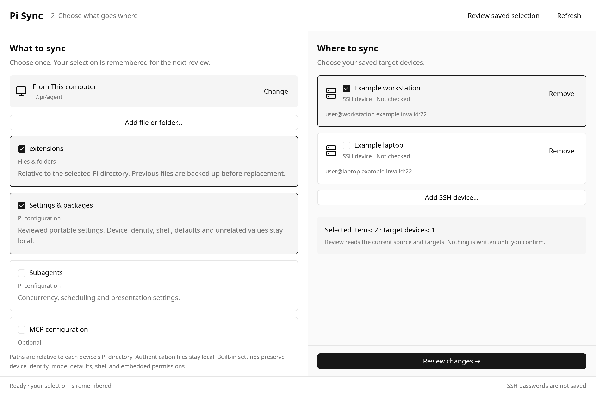

# Pi Sync Desktop

A native Rust + GPUI Kit workspace for reviewing Pi configuration changes before applying them to your computer or SSH devices. No Electron, webview, local web server, or browser UI.

**Early development build.** Core safety tests are automated. Native platform builds and actual-window validation are tracked separately in [verification](docs/verification.md). Do not mistake a source build for a signed, release-ready installer.



## Run from source

Requires Rust 1.92+, Node.js 20+ on the computer running the app, and Node.js 20+ on SSH destinations. Node is the dependency-free configuration worker, not the UI. SSH connections use your system OpenSSH client, its configured identities/agent, and native in-app password/passphrase and host-trust prompts. OpenSSH 8.7+ is required.

```sh
cargo run --locked -p pi-sync-desktop
```

On Linux, install the native [GPUI Kit build dependencies](https://gpui-kit.com/docs/installation/). macOS requires macOS 15+ and Xcode command-line tools; Windows requires the MSVC Rust toolchain and Visual Studio C++ build tools. See [development](docs/development.md).

## Workflow

1. On first launch, save one or more SSH connections, then choose **Next**. Saving a profile does not claim the connection works; host trust and authentication happen when reviewing.
2. This computer is the default source. The left pane selects what to sync; the right pane selects saved target devices. **Change** can still select another source or the public preset.
3. **Extensions**, **Skills**, **Prompt templates**, and **Themes** are built-in choices. A fresh local selection checks the standard folders that already exist safely inside your Pi agent directory; saved choices, including unchecked folders, stay unchanged. Use **Add file or folder** for the system picker: macOS has one **Choose files or folders** button; Windows and Linux keep separate **Choose files** and **Choose folders** buttons. Multiple selection is supported. Selections and targets are saved immediately, including before the first review.
4. **Review changes** opens a full-window comparison with safe source/target previews. **Review full file…** is available on every selected changed file, including models and MCP, after an explicit private-content warning. File copies and conflicts need an explicit Source, Target or Skip choice. **Cancel review** returns to the remembered selection without writing.
5. **Confirm sync** summarizes the actual targets and asks for final confirmation. Source and target changes invalidate the review. Connection failures are shown separately from a successful zero-difference result.

In review, click the left or right content pane to choose a version. A translucent arrow overlay appears on the hovered side and when keyboard-focused. Click an arrow for the previous (left) or next (right) hunk. Arrows only navigate: they never choose or change a version, even when you have not decided yet. The hunk counter and highlight make navigation visible even in a short diff. After the last hunk, the next click opens the next visible review item at its first hunk; previous from the first hunk opens the previous item at its last hunk. Navigation follows the sidebar and Pending filter, stopping at the ends without wrapping. Alt+Left/Right chooses a version and Alt+Up/Down navigates hunks. Use the sidebar to switch review items.

**Review full file…** opens a read-only full-file view. Settings, MCP and subagents show the target's current JSON and the proposed result of your current field choices, including preserved target-only fields. Undecided fields keep their target values and are labeled provisional. Models and custom files show the complete source and target candidates. Large files use Previous/Next page without truncation; binary or invalid UTF-8 contents use hexadecimal bytes with offsets. Highlight page differences compares the current pair of pages, not a whole-file change count. Use **Hide contents · back** to return to choices; viewing or paging never chooses a version or applies changes. Full-file contents are only shown after **Show contents**. A missing or unreadable source remains visibly unavailable rather than pretending it was reviewed.

**Review saved selection** reads fresh data with one click. It never reuses an old plan or silently applies remembered decisions. Local OS icons and generic SSH-device icons distinguish devices without guessing a remote platform.

The local picker accepts only items inside the configured Pi directory (`PI_CODING_AGENT_DIR`, otherwise `~/.pi/agent`). Its popup shows a **Copy path** shortcut for navigating there in the system chooser. Cancel leaves your selection untouched; an invalid batch adds nothing. Selecting `settings.json`, `mcp.json`, `subagents.json`, or `models.json` uses the existing audited built-in review. For an SSH source, the standard folders remain one-click choices; other paths use a clearly labeled remote relative-path entry because the system picker browses only this computer.

The four standard resource folders are `extensions/`, `skills/`, `prompts/`, and `themes/`, matching [Pi configuration documentation](https://github.com/earendil-works/pi/blob/7a52c2108daa4b8320389df53b5c504f2c9da1d3/packages/coding-agent/docs/configuration.md). Discovery checks these folders only, not arbitrary files, managed `npm/` or `git/` installs, temporary files, sessions, or credentials. Extension-specific folders such as `agents/` can still be selected explicitly. A missing selected folder blocks review with an instruction to create it or deselect it; it never deletes destination files.

Custom paths are relative to each configured Pi directory, not arbitrary absolute source/destination mappings. Folders are recursive; target-only files are never deleted and empty folders are not copied. Transfers allow 256 files, 4 MiB per file and 8 MiB total custom bytes. Symlinks, Git working trees, authentication/credential paths, hidden paths and nonportable names are blocked with an error rather than silently skipped.

## SSH setup

Enter `ssh user@host`, or an OpenSSH alias such as `ssh mac-mini`. Optional `-p port` and `-i key-path` are supported. New connections with an omitted user or port resolve those values through OpenSSH configuration; previously saved profiles keep their explicit user and port. Node.js 20+ must be available to the destination's noninteractive SSH session.

The app inherits its SSH agent environment when launched. An agent such as Bitwarden can supply keys through the system client when configured for it; unlock and approve access in the agent's own app. Restart Pi Sync after changing the agent environment. This is not a claim that your Bitwarden setup or Windows-to-Mac connection has been tested. Passwords and passphrases are never saved.

Install the OpenSSH Client optional feature on Windows, check the built-in `/usr/bin/ssh` and PATH on macOS, or `openssh-client` on Debian/Ubuntu Linux. Reopen Pi Sync afterward. Windows prefers the system OpenSSH client over a Git-bundled client. Setup shows the chosen client. Older clients that reject required options need an update; the app does not weaken server key-exchange settings.

Forwarding, proxy/jump hosts, local/remote commands, connection multiplexing and keyboard-interactive/MFA are not supported. Standard user known-hosts files and native global trust are supported alongside the app's trust file. Aliases with custom `UserKnownHostsFile` or `KnownHostsCommand` are blocked before connecting, not silently given a new trust store. OpenSSH configuration is trusted local code: `Match exec` can execute while it is being parsed. See [security](docs/security.md).

## Safety and scope

- Device ID, shell settings, default provider/model, and unrelated target values are preserved.
- Settings and packages, reviewed MCP fields, and reviewed subagent fields are supported. Unsupported fields remain local.
- Private models move only through private process pipes and encrypted device connections. They never enter the public repository or profiles. Ordinary review shows hashes; full contents appear only after explicit local reveal. The entire file is copied after review, with a backup of the previous bytes. Only source JSON readability is checked; Pi owns model compatibility. Invalid or unreadable source models can be skipped while other settings sync.
- Embedded permission settings stay local. Explicitly selected standalone permission files can be copied only through whole-file review, with a tool-access warning and an explicit choice. There is no semantic policy-weakening analysis.
- A successful operation keeps one recovery backup of the files involved in that operation. Partial failures retain recovery evidence instead of pruning it.
- Passwords/passphrases are not saved. Profiles contain connection information and Pi paths only; remembered selections contain identifiers and relative paths, never content. Changed SSH host keys fail closed.

See [security](docs/security.md) for limitations, data locations, and recovery. See [design](docs/design.md) for interaction and architecture decisions.

## Check

```sh
node --test backend/tests/*.test.mjs
node scripts/check-public.mjs
cargo test --locked --workspace
cargo fmt --all -- --check
cargo clippy --locked --workspace --all-targets -- -D warnings
```

Native binaries/installers and an `npx` launcher are not published yet. A small launcher could select a verified native release later; it would not change the native UI architecture.
